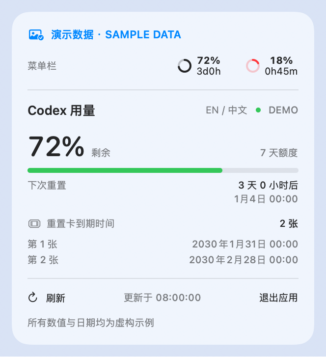

# Codex Usage for macOS

[简体中文](README.md) · English

Check your Codex remaining quota, reset times, and reset-card expiry dates from the macOS menu bar.

**Current recommended release is 1.8.1 (build 15).**

**[Download the latest version](https://github.com/ccrrfftt/codex-usage-menubar/releases/latest)**

  

Screenshot uses fictional demo data only.

- **Menu bar quota and reset.** The ring follows your remaining allowance and turns red below 20%. The percentage appears above the countdown for the same quota window. Click for details.
- **Reset cards:** view the available count and each card's expiry date.
- **Chinese and English:** click **EN / 中文** at the top right of the panel. Your choice is remembered.
- **Automatic updates:** every minute on AC power, every 5 minutes on battery; paused while asleep or offline.

## Install

Requires an **Apple Silicon Mac with macOS 14 or later**, and an installed Codex / ChatGPT desktop app signed in to your account.

The app searches both system and user Applications folders and recognizes renamed ChatGPT desktop installations. The bundled CLI path was checked against ChatGPT 26.1117.41037. A warning appears when the server blocks included usage.

1. Download and unzip the latest `Codex-Usage-VERSION-macOS-arm64.zip`.
2. Drag `Codex Usage.app` into **Applications**, then open it.

**Upgrade:** quit the old version before replacing the app. **Quit:** click **Quit** in the panel. **Uninstall:** quit, then move the app to Trash.

The current app is locally signed and has not been notarized by Apple.

A native app with no browser, Python, or API key requirement. It only reads usage information: it does not make model requests or redeem reset cards. It does not enable launch at login automatically.

---

[Development notes (Chinese)](DEVELOPMENT.md) · [Changelog (Chinese)](CHANGELOG.md) · [Icon attribution](Assets/README.md)

A personal project, not an official OpenAI app.

## License

Original source code and documentation in this project are licensed under the [MIT License](LICENSE). Third-party assets, including OpenAI names, icons, and marks shown in screenshots, are not covered by that license grant. See [Icon attribution](Assets/README.md).
