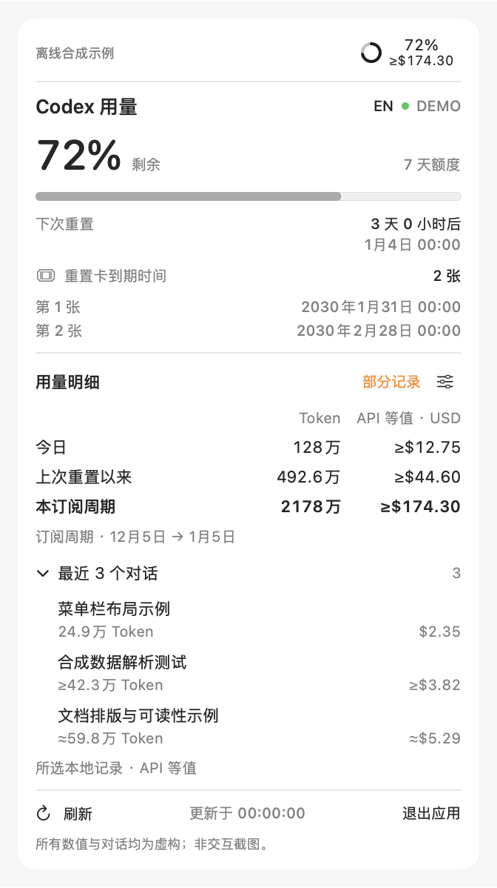

# Codex Usage for macOS

[简体中文](README.md) · English

Check Codex quota, reset times, and token API equivalents from the macOS menu bar.

This development branch is **1.7.0**, not yet released. The download link still points to the published version. See [accounting scope and limitations](docs/ACCOUNTING.md).

**[Download the latest version](https://github.com/ccrrfftt/codex-usage-menubar/releases/latest)**

  

Screenshot uses fictional demo data only.

- **Remaining-quota ring:** the arc follows your remaining allowance and turns red below 15%. The percentage stays beside it; click for details.
- **Tokens and API equivalents:** today, after the observed reset interval, the subscription cycle, and the last three conversations in selected sources. Configure your renewal day.
- **Explicit scope:** only selected project usage records are read. `≈` means estimated, `≥` a known lower bound, and `—` unavailable. Values use current Standard API prices, not billed charges.
- **Reset cards:** view the available count and each card's expiry date.
- **Chinese and English:** click **EN / 中文** at the top right of the panel. Your choice is remembered.
- **Automatic updates:** every minute on AC power, every 5 minutes on battery; paused while asleep or offline.

## Install

Requires an **Apple Silicon Mac with macOS 14 or later**, and an installed Codex / ChatGPT desktop app signed in to your account.

Version 1.6.2 is verified with Codex 26.928.20755 / CLI 0.159.0 and supports both system and user Applications folders. A clear warning appears when the server blocks included usage.

1. Download and unzip the latest `Codex-Usage-VERSION-macOS-arm64.zip`.
2. Drag `Codex Usage.app` into **Applications**, then open it.

**Upgrade:** quit the old version before replacing the app. **Quit:** click **Quit** in the panel. **Uninstall:** quit, then move the app to Trash.

The current app is locally signed and has not been notarized by Apple.

A native app with no browser, Python, or API key requirement. It only reads usage information: it does not make model requests or redeem reset cards. It does not enable launch at login automatically.

---

[Development notes (Chinese)](DEVELOPMENT.md) · [Changelog (Chinese)](CHANGELOG.md) · [Icon attribution](Assets/README.md)

A personal project, not an official OpenAI app.
