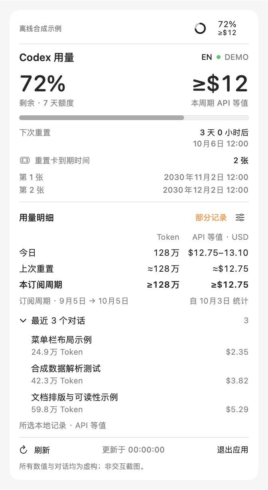

# Codex Usage for macOS

简体中文 · [English](README.en.md)

在 Mac 顶部菜单栏查看 Codex 额度、重置时间和 Token 的 API 等值。

**1.7.1**：菜单栏整数 K／M／B 显示，展开顶部突出本周期 API 等值，并显示真实对话标题。范围与限制见[统计说明](docs/ACCOUNTING.md)。

**[下载最新版](https://github.com/ccrrfftt/codex-usage-menubar/releases/latest)**

  

截图仅使用虚构演示数据。

- **圆环显示剩余额度**：弧长随剩余比例变化，低于 15% 变红；旁边保留百分比，点击展开详情。
- **Token 与 API 等值**：从首次启用当天累计今日、重置观测以后、本订阅周期和最近 3 个对话的用量；重启保留起点，支持续费日设置。
- **明确统计范围**：读取所选项目根目录及子目录对应的用量记录；估算用 `≈`、已知下界用 `≥`、未知用 `—`。金额采用当前 Standard API 单价，不是账单。
- **查看重置卡**：显示可用数量，以及每张卡的到期时间。
- **中英文切换**：在面板右上角点击「EN / 中文」，自动记住上次选择。
- **按供电状态刷新**：插电每 1 分钟，电池每 5 分钟；休眠、离线时暂停。

## 安装

需要 **Apple Silicon Mac、macOS 14+**，并已安装、登录 Codex / ChatGPT 桌面应用。

1.7.1 沿用已验证的 Codex 26.930.31730 / CLI 0.160.0 只读额度接口，支持系统和个人「应用程序」目录。服务端限制常规用量时，会显示明确提示。

1. 下载并解压最新版的 `Codex-Usage-版本号-macOS-arm64.zip`。
2. 把 `Codex Usage.app` 拖进「应用程序」，双击打开。

**升级**：先退出旧版，再替换 App。**退出**：点击面板中的「退出应用」。**删除**：退出后把 App 移到废纸篓。

当前安装包使用本地签名，尚未经过 Apple 公证。

原生应用，无需网页、Python 或 API Key；只读查询用量，不发起模型请求、不使用重置卡。不自动设置开机启动。

---

[开发说明](DEVELOPMENT.md) · [更新记录](CHANGELOG.md) · [图标来源](Assets/README.md)

个人项目，非 OpenAI 官方应用。

## 许可证

本项目的原创源码和文档采用 [MIT 许可证](LICENSE)。OpenAI 名称、图标等第三方素材（包括截图中的相关标识）不在该许可的授权范围内，详见[图标来源](Assets/README.md)。
